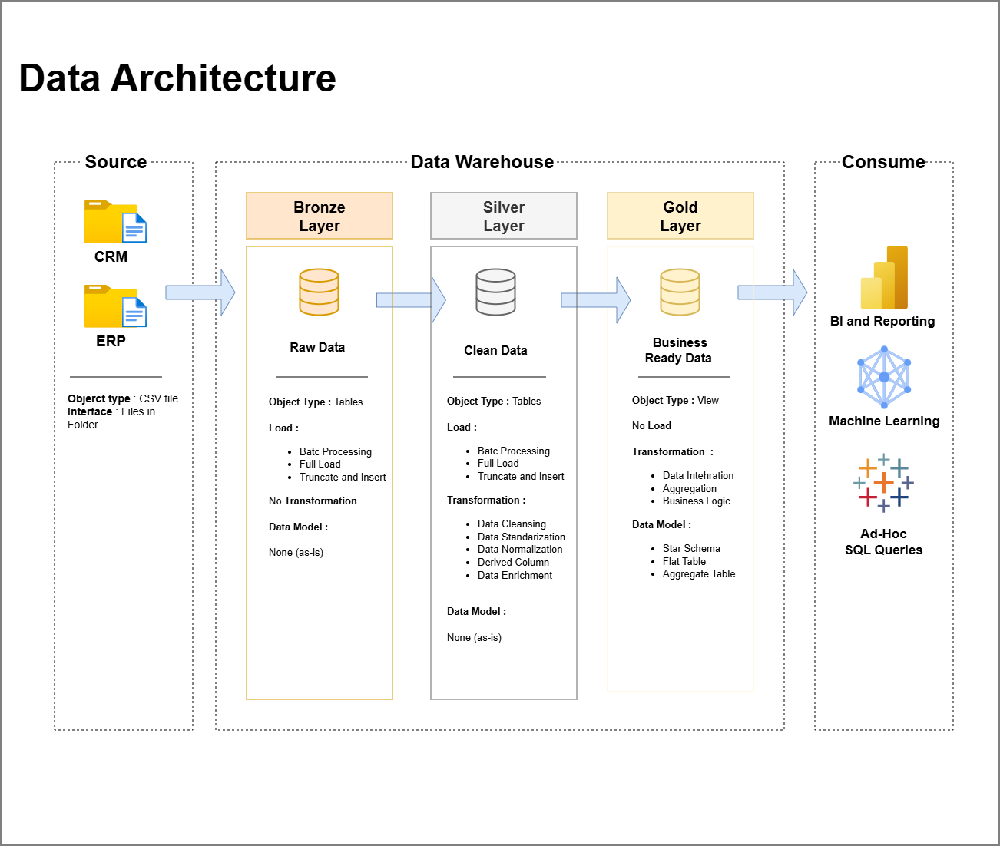

# SQL Data Warehouse Project


A data warehouse built in **SQL Server** using the **Medallion Architecture** (Bronze → Silver → Gold). It takes raw CSV files from two source systems (a CRM and an ERP), cleans them, and models them into a star schema ready for analysis.

> **Learning project:** I built this while following the *Data Warehouse* project by [Data With Baraa](https://youtu.be/SSKVgrwhzus). The dataset, project structure, and original design come from his course. See [Credits](#-credits).

---

## 👋 About This Project

I'm an **Animal Science graduate** (Universitas Gadjah Mada, 2025) with a background in the food and livestock industry, and I'm currently shifting my career into **data analytics**. I'm learning SQL, Python, and Power BI through self-directed study, and this project is where I practice SQL end to end:

- Taking messy, real-world-style data from multiple systems
- Cleaning and standardizing it
- Modeling it so that a business question can be answered with a single query

My goal is to work as a **data analyst**, and this repository is part of my portfolio as I build toward that.

---

## 🏗️ Data Architecture

The project follows the **Medallion Architecture**:



| Layer | Purpose | What happens here |
|:--|:--|:--|
| **Bronze** | Raw data | CSV files from CRM and ERP are loaded into SQL Server as-is, with no changes |
| **Silver** | Clean data | Cleansing, standardization, normalization, and fixing data quality issues |
| **Gold** | Business-ready data | Star schema (facts and dimensions) built for reporting and analytics |

---

## 📂 Repository Structure

```
sql-data-warehouse-project/
├── 01_datasets/            Six source files
│   ├── source_crm/         Three files from the CRM system
│   └── source_erp/         Three files from the ERP system
├── 02_docs/                Requirements, architecture and data model diagrams, notes
├── 03_scripts/
│   ├── init_database.sql   Creates the database and schemas (run first)
│   ├── bronze/             Loads raw files
│   ├── silver/             Cleans and prepares the data
│   └── gold/               Builds the analytical views/tables
└── 04_tests/               Data quality checks for silver and gold
```

---

## 🎯 Project Requirements

### Part 1: Building the Data Warehouse (Data Engineering)

- **Data sources:** two systems (ERP and CRM), delivered as CSV files
- **Data quality:** find and fix quality issues before analysis
- **Integration:** combine both sources into one data model designed for analytical queries
- **Scope:** latest dataset only, no historization
- **Documentation:** clear documentation of the data model for both business and analytics users

### Part 2: Analytics & Reporting (Data Analysis)

SQL-based analysis covering:

- **Customer behavior**
- **Product performance**
- **Sales trends**

Full details are in [`02_docs/requirements.md`](02_docs/requirements.md).

---

## 🔄 What I Did

1. **Designed the architecture:** planned the three layers and how data flows between them
2. **Built the ETL pipelines:** loaded the six source files into Bronze, then transformed them into Silver
3. **Modeled the data:** created the Gold layer as a star schema with fact and dimension tables
4. **Tested the data:** wrote quality checks (duplicates, nulls, invalid values, consistency between sources)
5. **Analyzed the results:** answered business questions about customers, products, and sales with SQL

---

## 💡 What I Learned

- How data from different systems has to be integrated, even when the same customer or product appears differently in each one
- Common data quality problems (duplicates, nulls, inconsistent formats, invalid dates) and how to handle them in SQL
- Why separating raw, cleaned, and business-ready data makes a pipeline easier to debug and trust
- How to design fact and dimension tables so analysis is simple
- Using stored procedures to make loading repeatable
- Documenting a data model so other people can understand it

<!-- Add your own lessons here: what was hardest, what surprised you, what you'd do differently. -->

---

## 🛠️ Tools Used

- **SQL Server** and **SSMS**: database and development environment
- **Git / GitHub**: version control and portfolio
- **draw.io**: architecture and data model diagrams
- **Notion**: project planning

---

## ▶️ How to Run

1. Install SQL Server and SSMS.
2. Place the project folder at `C:\sql\dwh_project\`, or edit the six file paths in `03_scripts/bronze/proc_load_bronze.sql`.
3. Run the scripts in this order:
   1. `03_scripts/init_database.sql`
   2. Bronze layer scripts, then execute the load procedure
   3. Silver layer scripts, then execute the load procedure
   4. Gold layer scripts
4. Run the checks in `04_tests/` to validate the data.

---

## 🚀 What's Next

- Connect the Gold layer to **Power BI** and build a dashboard
- Rebuild parts of the cleaning and analysis in **Python**
- Apply the same approach to a dataset from a domain I know well: food and livestock

<!-- Edit this list to match your real plans. -->

---

## 🙏 Credits

This project is based on the *Data Warehouse Project* by **Baraa Khatib Salkini** ([Data With Baraa](https://www.datawithbaraa.com)). The original materials are published under the MIT license:

- Video: [Data Warehouse project walkthrough](https://youtu.be/SSKVgrwhzus)
- Original repository: [DataWithBaraa/sql-data-warehouse-project](https://github.com/DataWithBaraa/sql-data-warehouse-project)

I followed the course to learn, and the README, notes, and any changes I made are my own work.

---

## 🛡️ License

This project is licensed under the [MIT License](LICENSE). Original work © Baraa Khatib Salkini; see the license file for attribution.

---

## 📬 Connect With Me

**Azim**
- LinkedIn: [https://www.linkedin.com/in/abdulazimqutb/]
- GitHub: [azimqutb]
- Email: [abdulazimqutb@gmail.com]
